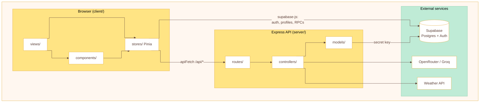
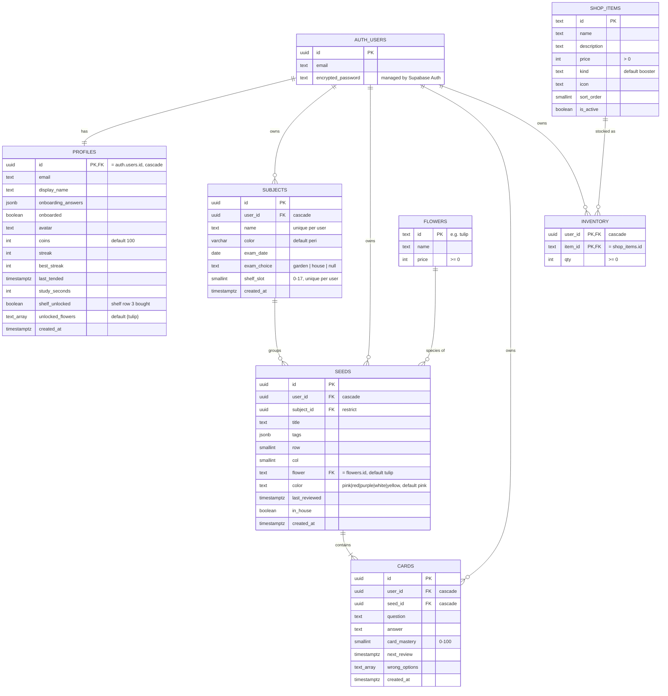

// To be deleted before submission

# Memory Garden: shared conventions

This guide is for everyone on the team and for the AI tools we use. **Paste it into your prompt, or tell the AI to read `Consistent.md` first**, so new code matches the existing styles and design.

The goal is that we can restyle the frontend later by editing `client/src/style.css` alone, without hunting through every component.

---

## 0. Prompt preamble (copy this into your AI prompt)

```text
Follow Consistent.md in the repo root.
- Styling: use the CSS variables and classes in client/src/style.css plus Bootstrap 5 utilities.
  No hard-coded colours, fonts or shadows in components. If something is missing, add a token
  or class to style.css and use that.
- Component-only CSS goes in <style scoped> and may only use var(--token) values.
- Data: follow the "who talks to what" table. Seeds/cards go through the Express API
  (lib/http.js apiFetch). Auth, profiles and RPCs go through Supabase directly (lib/supabase.js).
- Database changes: make them in the Supabase dashboard (with RLS/grants), then refresh
  server/supabase/schema.sql. Anything that spends or awards coins is an RPC, not a client-side update.
- Don't commit.
```

---

## 1. Stack

| Layer | Tech | Entry point |
|---|---|---|
| Frontend | Vue 3 (`<script setup>`), Pinia, Vue Router, Vite | `client/src/main.js` |
| Styling | Bootstrap 5.3 for layout utilities, plus our own `style.css` | loaded in `main.js` (Bootstrap first, then `style.css`) |
| API server | Node + Express | `server/src/server.js` |
| Database / auth | Supabase (Postgres, Auth, RLS) | live project; snapshot in `server/supabase/schema.sql` |
| AI | OpenRouter (GPT-4.1), with Groq as backup | `server/src/lib/ai.js` |

---

## 2. Styling: one CSS source

### 2.1 Rules

1. **`client/src/style.css` is the single source of truth** for colours, fonts, shadows, radii and shared components.
2. **Never write a hex/rgb colour, font-family or shadow in a component.** Use `var(--token)`. If you need a new colour, add it to `:root` in `style.css` with a name, then use it.
3. **Layout uses Bootstrap utilities** (`d-flex`, `gap-2`, `align-items-center`, `flex-column`, `w-100`, `m-0`, `mb-3` …). Don't write custom CSS for spacing or flex when a utility exists.
4. **Text uses our type classes** (section 2.3), not Bootstrap's `fs-*`/`fw-*`, and not raw `font-size`.
5. **Component-specific CSS goes in `<style scoped>`** and only uses tokens. A style needed in 2 or more components moves into `style.css` as a class.
6. **Tag and seed colours come from `client/src/lib/tagColors.js`** (`tagStyle(id)`, `SEED_COLORS`). Don't redefine them.

### 2.2 Colour and effect tokens (`:root`)

| Token | Value | Use for |
|---|---|---|
| `--bark` | `#5A3E36` | Main text colour |
| `--bark-muted` | `#8A7268` | Secondary or small text |
| `--paper` | `#fff` | Card and surface backgrounds |
| `--cream` | `#FFF7F0` | Soft backgrounds (counters, product art) |
| `--linen` | `#F3E3D8` | Borders, tracks, segmented control background |
| `--peach` | `#FFB5A7` | Primary button background |
| `--berry` | `#F27A8E` | Primary button "lip", hover accents |
| `--berry-ink` | `#A8304A` | Primary button text, errors (`.text-danger`) |
| `--butter` / `--butter-deep` | `#FFE484` / `#E0A93A` | Secondary button and its lip, badges |
| `--mint` / `--mint-deep` | `#BFEBD6` / `#7FC9A6` | Progress fill, success |
| `--periwinkle` / `--peri-soft` | `#8FA4FF` / `#E6EBFF` | Focus rings, avatar, text selection |
| `--lilac` | `#C7B5FF` | Accent |
| `--shadow` | `rgba(39,49,30,.48)` | Overlay backdrop colour |
| `--shadow-card` | `rgba(107,74,58,.18)` | **A colour**, used inside a `box-shadow`, e.g. `0 8px 24px -6px var(--shadow-card)` |
| `--radius-pill` | `10px` | Segmented control and scrollbar radius |
| `--spring` | `cubic-bezier(.34,1.56,.64,1)` | Bouncy transitions |

### 2.3 Typography classes

The fonts are **Fredoka** (headings, labels, numbers) and **Nunito** (body text).

| Class / element | Font | Size / line height | Use for |
|---|---|---|---|
| `.text-display` | Fredoka 600 | 48 / 56 | Hero titles |
| `h1` / `h2` / `h3` | Fredoka 600 / 600 / 500 | 36/44, 28/36, 22/30 | Page and section headings |
| `.text-button` | Fredoka 600 | 16 / 24 | Button labels |
| `.text-stat` | Fredoka 600 | 28 / 32 | Big numbers (profile stats) |
| `.text-timer` | Fredoka 500 | 64 / 64, tabular numbers | Pomodoro timer |
| `p` | Nunito 400 | 16 / 26 | Body text |
| `.text-body-strong` | Nunito 700 | 16 / 26 | Emphasised body text |
| `.text-body-small` | Nunito | 14 / 22, muted | Hints, metadata |
| `.text-label-field` | Nunito 700 | 14 / 20 | Form labels |
| `.text-label-caption` | Nunito 700 | 12 / 16, uppercase | Badges, tiny captions |
| `.text-danger` | none | `--berry-ink` | Error messages |

### 2.4 Shared component classes

| Class | What it is |
|---|---|
| `.btn-primary` | Peach pill button with a berry lip. Use with Bootstrap's `.btn`. |
| `.btn-secondary` | Butter pill button with a butter-deep lip. Has a disabled state. |
| `.counter` | Pill showing a number (coins, streak) |
| `.avatar` | 32px round avatar |
| `.segmented-control` + `.segmented-tab` (`.is-active`) | Tab switcher |
| `.progress` + `.progress-fill` | Mastery or progress bar |
| `.tag-pill` | Tag chip. Colour it with `:style="tagStyle(id)"`. |
| `.badge` | Small butter label |
| `.overlay` | Fullscreen modal backdrop |
| `.product-card`, `.product-art`, `.packet-art`, `.product-name`, `.product-empty`, `.product-locked` | Shop and inventory cards |
| `.review-page`, `.review-container`, `.score-pill`, `.review-progress-fill`, `.review-stat`, `.claim-btn` | Review session pages: page shell, ✓ count pill, progress fill, results stat box, claim button |

### 2.5 Known style gaps (don't copy these; fix them when you touch them)

- `.segmented-tab` uses `var(--font-heading)`, which is **not defined**. Add `--font-heading: 'Fredoka', sans-serif;` (and `--font-body`) to `:root`.
- `.segmented-tab.is-active` uses `box-shadow: var(--shadow-card)`, but that token is a colour, so the shadow doesn't show. It needs offsets, e.g. `0 2px 6px var(--shadow-card)`.
- `.btn-primary` has a fixed `width: 193px` and Figma leftovers (`order: 4`, `flex: none`). It also replaces Bootstrap's `.btn-primary`.
- These components still contain hard-coded hex colours: `Skybox.vue` (10), `FlowerShelf.vue` (4), `PlantSeedForm.vue` (4), `FocusPlayer.vue`, `SessionTodo.vue`, `PomodoroView.vue`. Skybox's sky gradients may need their own tokens.
- `client/src/lib/seedColors.js` is empty. `SEED_COLORS` lives in `tagColors.js`.

---

## 3. Logical design

### 3.1 Architecture



### 3.2 Who talks to what

| Data / action | Path | Why |
|---|---|---|
| Sign in / out, session | Browser → Supabase Auth (`stores/auth.js`) | Supabase Auth is designed to run in the browser |
| Register | Browser → `POST /api/auth/register` → Supabase admin API | Needs the secret key, and validates input |
| Read / update own profile | Browser → `profiles` table (RLS + column grants) | Simple, owned by the user |
| Coins, shelf, study time, exam choice | Browser → **RPC** (`unlock_shelf`, `add_study_time`, `choose_exam_outcome`, …) | Runs as one transaction, so the client can't cheat or half-apply it |
| Seeds and cards (list, create, review, delete) | Browser → `/api/seeds/*` → `models/seedModel.js` | Mastery, spacing and priority rules live on the server |
| Document → flashcards | Browser → `POST /api/seeds/generate` → `lib/ai.js` | Keeps the AI keys on the server |
| Weather | Browser → `GET /api/weather` | Keeps the API key on the server |

API endpoints today: `POST /api/auth/register`, `GET|POST /api/seeds`, `POST /api/seeds/generate`, `PATCH|DELETE /api/seeds/:id`, `POST /api/seeds/:id/grade`, `POST /api/seeds/:id/reviews`, `GET /api/weather`.

### 3.3 Folder responsibilities

| Folder | Put here | Don't put here |
|---|---|---|
| `client/src/views/` | One file per route; page layout | Raw `fetch` calls, business rules |
| `client/src/components/` | Reusable UI; props in, events out | Direct database calls |
| `client/src/stores/` | State plus all calls to the API or Supabase | Markup or CSS |
| `client/src/lib/` | Pure helpers (`http.js`, `supabase.js`, `plantStage.js`, colours) | Vue state |
| `server/src/routes/` | URL → controller mapping | Logic |
| `server/src/controllers/` | Input validation, HTTP status codes | SQL / Supabase queries |
| `server/src/models/` | Supabase queries, always filtered by `user_id` (the secret key bypasses RLS) | `req` / `res` |
| `server/supabase/schema.sql` | Snapshot of the live database structure, refreshed after each schema change | User data, hand-written partial changes |

### 3.4 ER diagram

Built from the live Supabase database (checked 2026-10-23), the same as `server/supabase/schema.sql`. There are 7 public tables.



**Notes**

- **Seed = one plant.** A garden plant is a seed row. `row`/`col` place it in the garden; `flower`/`color` set how it looks.
- **Mastery is stored on cards only.** Seed and subject mastery are calculated by averaging `card_mastery` (`seedModel.js`), so the design stays normalised.
- **`user_id` on seeds and cards is denormalised.** It could be reached through subject → user, but storing it lets RLS and queries filter by owner directly.
- **Seed → cards is 1..many.** The controller enforces it (1 to 200 cards per seed); the schema doesn't.
- **Subject → seeds is 0..many.** A subject is created along with its first seed, but it stays when its seeds are deleted. `ON DELETE RESTRICT` blocks deleting a subject that still has seeds.
- **`auth.users`** belongs to Supabase. The `on_auth_user_created` trigger makes a `profiles` row for every new user.
- **Flower unlocks:** `buy_flower` adds to `profiles.unlocked_flowers` and spends coins. The `seeds_guard_flower` trigger (`guard_seed_flower`, before insert/update of `flower`) rejects a seed whose flower isn't in the owner's `unlocked_flowers`.
- **Shop:** `flowers`, `shop_items` are readable by any signed-in user; `inventory` only by its owner. All writes go through `buy_item` / `use_item` / `buy_flower` (all `SECURITY DEFINER`, `FOR UPDATE`).
- **Profile column grant:** the client may update `email, display_name, avatar, onboarding_answers, onboarded, streak, best_streak, last_tended, coins`. `unlocked_flowers`, `study_seconds` and `shelf_unlocked` are RPC-only.
- `wrong_options` is a Postgres `text[]`. It's written as `text_array` because Mermaid doesn't accept `[]`.

### 3.5 Database change rules

1. Make changes in Supabase (SQL editor or Table editor).
2. **Then refresh `server/supabase/schema.sql`** so the repo keeps a full copy. It's one snapshot file; don't add separate migration files. Regenerate it from the live database (ask the AI to "re-dump schema.sql from Supabase") rather than hand-editing it.
3. **A new table** needs RLS turned on, policies limiting rows to `auth.uid()`, and grants for the role that uses it.
4. **A new profile column the client writes** must be added to the column grant (`GRANT UPDATE (...) ON public.profiles` in `schema.sql`). Otherwise the update fails with `42501 permission denied`. This is what froze the streak.
5. **Anything involving coins, unlocks or limits is an RPC** (`SECURITY DEFINER`, checks `auth.uid()`, locks rows with `FOR UPDATE`). Follow the pattern of `unlock_shelf` or `buy_item`.
6. **After a schema change**, update the ER diagram above.

### 3.6 Known gaps in the logical design

- The quiz and Pomodoro rewards update `coins` directly from the client (allowed by the column grant), so a user could change their own coins. Moving the rewards into an RPC would close this.
- Several stores catch errors with `.catch(console.error)`, so failures are silent. Prefer showing a warning with `useToastStore().show({ type: 'warning', message })`.
